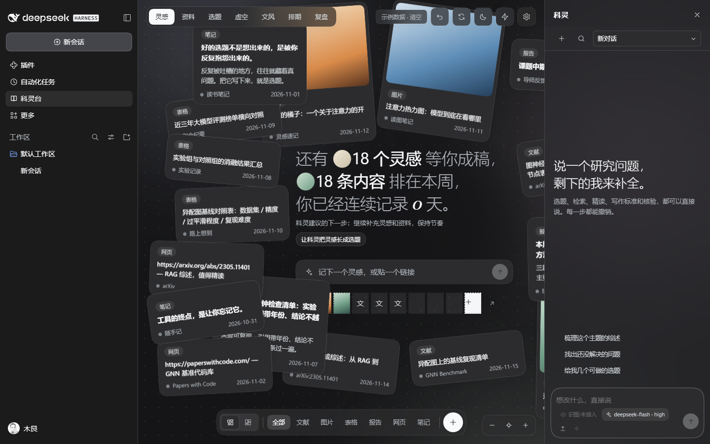
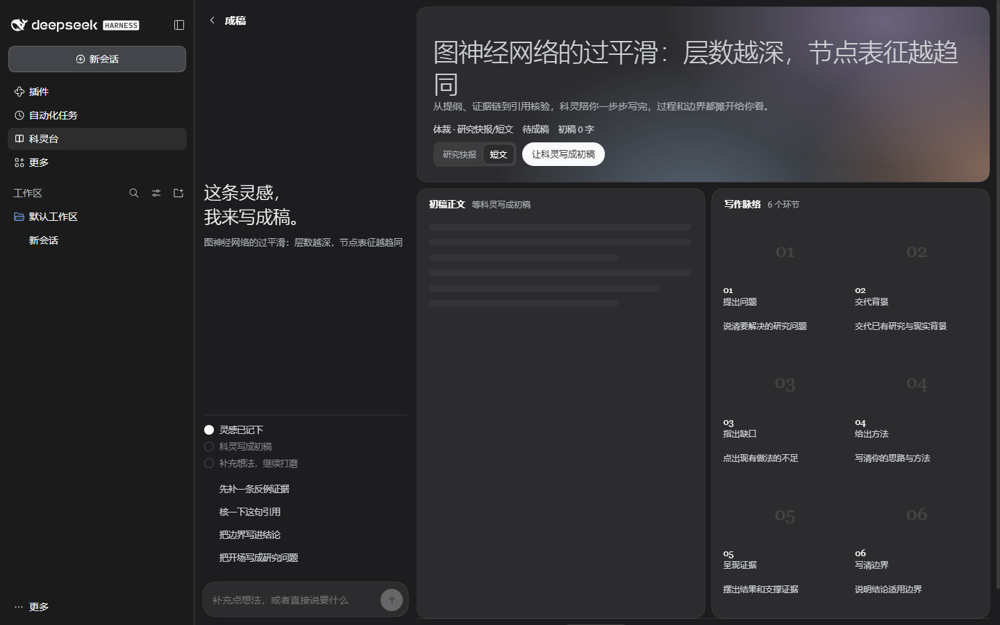
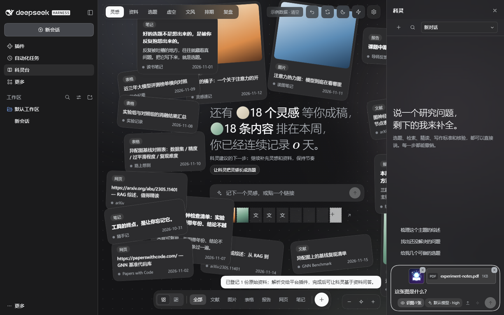
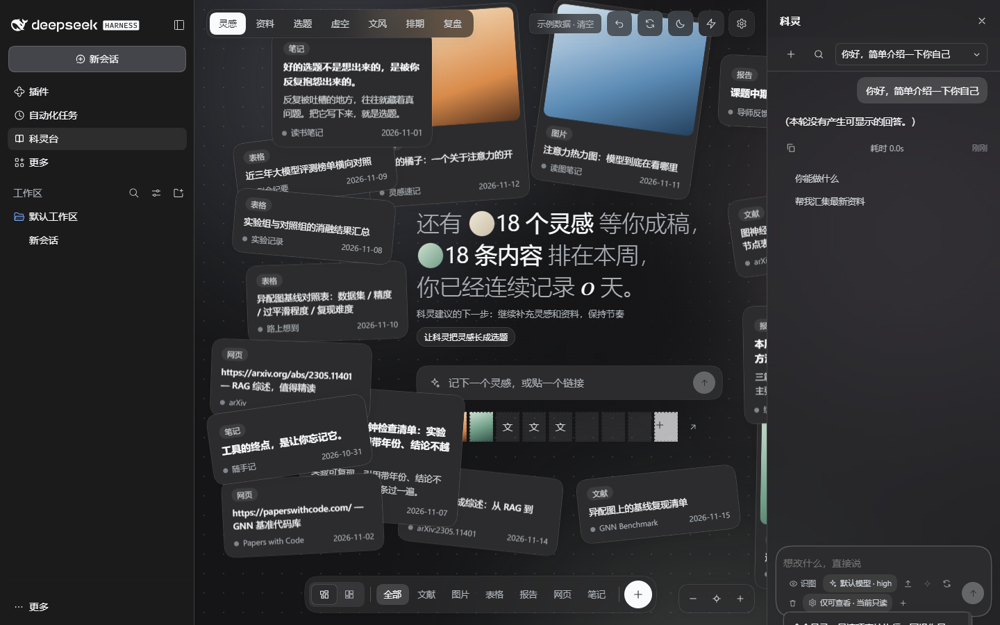

> **给第一次来的你：请先读这一段。**
>
> 科灵台（全称「科学灵感工作台」）是一个**正在快速开发中、尚不成熟**的科研灵感工作台。它是 DeepSeek Harness（DSH）的一个插件，目前**意外地被上架到了 dshmarket**——作者本意是它还在内部快速迭代、远未定型。因此，本文档不把它包装成"完成的成品"，而是**如实告诉你它现在能做什么、不能做什么、走到哪一步了**。
>
> 如果你期待一个稳定、功能完整、开箱即用的科研平台，现在可能还不是时候；如果你愿意和一个还在成长的工具一起打磨、并随时反馈，那我们很欢迎你（见文末反馈渠道）。
>
> 文档取证日期：2026-11-20 · 对应代码版本：`0.3.4`（含识图接通 `41ac997`）· 包名 `dsh-research-desk` · 所有状态描述均以源码逐字回盘为准。
>
> **开发状态速览（请先看清再决定是否使用）**
>
> | 维度 | 当前状态 |
> | --- | --- |
> | 开发阶段 | 早期快速迭代，**远未定型**（本次是意外上架，作者本意仍在内部打磨） |
> | 功能实现 | **远未完成**：核心链路（检索→精读→问答→选题→草稿）可跑，但多个环节仍是半成品或在探索中；逐项完成度见第 4 节 |
> | 测试 | **远未完成**：只有基础单元测试，端到端与真机验收覆盖严重不足，且仍有已知未通过的用例；不要把它当作经过完整测试的稳定软件 |
> | 稳定性 | **不保证**：可能出现后端路由未挂、界面与后端不同步、会话归属漂移等问题；遇到问题请按第 9 节反馈 |
>
> 一句话：**这是一个开发中的实验性产品，功能和测试都远未完成，请仅作尝鲜与反馈之用，勿用于正式科研流程。**

# 科学灵感工作台（科灵台，dsh-research-desk）

> **命名定义（既定，全文统一）**：本产品的全称是**科学灵感工作台**，简称**科灵台**；科灵台里的 AI 助手叫**科灵**。下文凡「科灵台」均指这个工作台，凡「科灵」均指其中的 AI 助手。

**科灵台**（科学灵感工作台）是 DeepSeek Harness 里的一个科研灵感工作台：把「记灵感 → 找资料 → 精读问答 → 推选题 → 写综述 → 跑验证 → 导出」这条科研工作流，做成侧栏里的一个面板，外加一个给 agent 用的工具入口。它的 AI 助手叫**科灵**。

它有一个朴素的目标——成为**全流程、可成长的研究助手**：尽量触及科研的每个环节，陪你一起越用越默契。

---

## 1. 定位：科灵、科灵台与你

项目内部用一组比喻来定义三者的关系，这也是整个产品设计的出发点：

- **科灵 = 器灵**：它的"天赋"由底层大语言模型（LLM）决定。
- **科灵台 = 肉身**：它是科灵修炼、施展能力的场所——也就是你正在看的这个工作台（Harness 侧的界面与能力）。
- **你 = 使用者**：因为人类研究者的存在，才有了让科灵与人交互更顺的一切设计。
- **共成长 = 修行**：你用得越深、反馈越多，科灵与科灵台越贴合你的研究习惯。

一句话：**LLM 是天赋，Harness 是修炼场，二者共同决定科灵这个"Agent"的能力**；科灵台就是那个修炼场，而你，是让它不断成长的人。

它**不是**：通用文献管理器（Zotero 已做得很好）、同行评审裁判、选刊顾问，或替你做不可逆实验决策的自动机。它只做"研究流程的状态与证据链"，引文、PDF 与重计算交给更专业的工具。

---

## 2. 设计理念、理想与逻辑

**理想**：让每一位研究者都有一个越用越懂自己的 AI 研究伙伴——把检索、核验、整理这些重复劳动交给科灵，把判断、审美与创造牢牢留给人自己。

**设计理念**：工具应当"拿来就能用"，不该逼研究者先学会配置；每一条结论都要能回到原文证据，宁可诚实地说"没找到"，也绝不编造；能力边界要如实摆在你面前，而不是藏在文档里等你踩坑。

以下三条设计原则贯穿整个科灵台（摘自项目 UI 章程，均为可追溯的原文，而非口号）：

1. **全流程、可成长**（北极星）：触及科研所有环节，协助收集 / 发现 / 整理 / 发表，越用越默契。（原始表述不含数值模拟执行，此处不扩写。）
2. **合作关系，不是使唤也不是托管**：共同目标、过程可见、科灵主动——科灵会带队（lead + 角色），关键处留给你拍板。
3. **能力边界如实上屏**：凡是你需要知道的限制，都用白话直接显示在界面上，而不是藏在文档里让你误以为"被保护"。

由此派生出两条工程约定（是手段，不是目标）：

- **逐字核验，防编造**：问答与综述里每条引文都要回到原文片段逐字比对，对不上就剔除并明确告诉你"没找到"——**没有命中就不是答案，是一次诚实的"没找到"**。
- **服务端算好、客户端只渲染**：复杂判断在服务端完成，界面只负责把结果用人话呈现给你。

---

## 3. 核心功能（七个页签）

侧栏打开科灵台后，顶部是 7 个页签（逐字见 `lib/client.js:1435`）：

| 页签 | id | 它做什么 |
| --- | --- | --- |
| 灵感 | `home` | 随时速记你的灵感和素材（文献 / 图片 / 表格 / 报告 / 链接 / 笔记六类）。目前是平铺时间流。 |
| 资料 | `discover` | 免密钥检索 arXiv / Europe PMC / OpenAlex，抓全文、切块、维护阅读库。 |
| 选题 | `research` | 从文献库摘要推出可证伪的选题，每条带"缺口"和"能杀死它的最便宜实验"。 |
| 虚空 | `lab` | 团队协作空间：把目标交给科灵，它带队走多智能体执行路径，看时间线、实验总览与决策区。 |
| 文风 | `style` | 管理写作风格，让科灵按你选的风格起草。 |
| 排期 | `schedule` | 排科研计划看板。 |
| 复盘 | `insights` | 汇总统计与复盘视图。 |

### 3.1 界面导览：一眼看懂科灵台

下面这张图是科灵台的**灵感首页**（界面示意图，取自开发中的干净实例，展示的是内置示例数据）。从左到右分为三栏：



- **左侧 · 会话与工作区**：顶部「新会话」用来开一段干净对话；下方是插件列表（科灵台在此）与工作区。
- **中间 · 灵感工作台**：顶部是七个页签（灵感 / 资料 / 选题 / 虚空 / 文风 / 排期 / 复盘）；页面主体是灵感卡片瀑布流，中央 hero 会实时告诉你「还有多少灵感等你成稿、多少内容排在本周、连续记录多少天」；底部是好用的灵感输入框（记一句话或贴一个链接）与分类筛选（全部 / 文献 / 图片 / 表格 / 报告 / 网页 / 笔记）。
- **右侧 · 科灵对话区**：这就是 AI 助手**科灵**。新会话时它显示欢迎语「说一个研究问题，剩下的我来补全」，并给出三句可直接点的建议（梳理主题综述 / 找出还没解决的问题 / 给我几个可做的选题）。你说研究问题，科灵负责检索、精读、写标准与核验，每一步都能撤销。

> 说明：这是开发版的**界面示意图**，用于让你直观感受布局与交互；实际数据、模型与功能完成度以第 4 节为准。

### 3.2 成稿页：从一条灵感，写成可核验的稿

在灵感首页点任意灵感卡，就进入成稿页。科灵陪你把这条灵感从提纲、证据链走到引用核验，过程与能力边界都摊开给你看：



- **顶部 · 这一稿是什么**：大字标题就是灵感本身，下面一句说清科灵怎么陪你写；「研究快报 / 短文」是体裁选择，右侧只有一个主行动「让科灵写成初稿」。
- **左侧 · 进度与对话**：三步进度（灵感已记下 → 科灵写成初稿 → 补充想法继续打磨）让你随时知道走到哪；下面是四条能直接点的打磨建议（补反例证据 / 核引用 / 写边界 / 写成研究问题）和补充想法的输入框。
- **中间 · 初稿正文**：科灵写出的初稿在这里，字数按真实内容显示；还没写之前是骨架占位。
- **右侧 · 写作脉络**：六个环节（提出问题 / 交代背景 / 指出缺口 / 给出方法 / 呈现证据 / 写清边界）是写作路标，帮你看清一段研究该讲清什么。

> 说明：这也是开发版的**界面示意图**。写作脉络是写作提示，不是已实现的证据核验面板；成稿目前由科灵基于灵感标题生成短文或研究快报，真正的能力完成度以第 4 节为准。

### 3.3 粘贴附件：像 DSH 会话框一样把图和文件放到输入框上方

科灵的输入框支持直接粘贴（Ctrl+V）或选择图片与文件，处理方式沿用 DSH 原生会话的设计：附件先以缩略图 / 文件卡片的形式出现在输入框**上方、靠左对齐**（与 DSH 原生会话一致），文字照常输入，发送时才一并交给科灵。



- **图片**：粘贴或选择后立即生成缩略图（先用本地预览，不提前读取内容），点右上角 × 可移除；发送时才读出图片数据随消息送给视觉模型，因此识图仍需先切换到视觉模型。
- **文件**：PDF / Word / PPT / Excel / txt / md 等文档以「扩展名徽标 + 文件名 + 大小」卡片呈现，同样可移除；发送时文件字节随消息进入宿主，经 DSH 原生附件服务提纯为受管附件，科灵再用读取工具打开文件逐字查看，因此能真正基于内容回答（不再只是登记文件名）。前提是宿主与科灵同机、可访问附件的保存路径。
- **克制的能力边界**：不支持的类型会明确提示可用范围；单次最多 4 张图片、单张不超过 4MB；文件分析依赖同机可读取的附件路径，读不到时科灵会如实说明而不会编造内容。

> 说明：这是开发版的**界面示意图**（用开发实例模拟粘贴后的附件条外观）。真实系统剪贴板的粘贴通路请在你的 GUI 中实际验证；功能完成度以第 4 节为准。

### 3.4 对话交互：信息行、权限盾牌与命令目录

科灵对话区在输入与输出两侧对齐 DSH 原生会话的必要基础交互，并按科灵台的研究定位做取舍——只搬真实能力，不摆没有底座的按钮。


- **输出侧 · 信息行**：每条回答下方按 DSH 原生的视觉语法收拢「复制 / 用量 / 相对时间」——复制可直接用；用量与耗时来自真实 LLM 统计；时间只在消息带时间戳时显示，缺数据就留空，不编造。思考过程与工具轨迹仍可折叠查看，过程对你可见。
- **输入侧 · 权限盾牌**：输入框工具行显眼处常驻「当前只读」标识，点开进入权限设置。选更高档只是记下偏好、不会立刻提权，安装 / 发包等高风险动作仍需在决策区由你拍板——这是刻意的安全设计，不是待补的缺陷。
- **输入侧 · 命令目录（+ 号）**：点「+」展开命令目录，列出服务端真实提供的 action。只读类命令可直接执行；需要参数的命令只把提示填进输入框、不擅自执行，由你补全后再发送。没有底座的第三方按钮（如自动循环、赞踩、排序、脑图、分享）明确不做，不会用假按钮糊弄。



> 说明：这两张是开发版的**界面示意图**，用于直观展示布局与交互；示意图中的回答与用量受开发实例模型路由影响，不代表真实回答质量或能力完成度。请以第 4 节的进度说明与你自己 GUI 中的实际体验为准。

支撑这些页签的，是服务端 **44 个真实 action**（`lib/host.mjs:38`，并在 `:1628` 起的 switch 中逐一分发到真实实现），按能力归类：

| 能力域 | 代表性 action |
| --- | --- |
| 状态 / 模型 / 设置 / 统计 | `status`、`models`、`settings`、`stats` |
| 文献检索与库管理 | `search`、`add`、`library`、`read`、`remove` |
| 有锚点问答与多会话对话 | `ask`、`chat`、`chat_new`、`chat_switch`、`chat_search`、`update_profile` |
| 选题 / 综述 / 草稿 | `hypothesis`、`review`、`gaps`、`draft` |
| 实验与验证 | `experiment_design`、`run`、`experiment_analyze`、`experiment_iterate` |
| 导出 / 导入 | `export`、`import` |
| 历史 / 回滚 | `undo`、`history`、`restore`、`clear` |
| 团队协作（虚拟实验室） | `collab_create`、`collab_step`、`collab_plan`、`collab_decision_ask`、`collab_decision_answer`、`collab_run`、`collab_evaluate`、`collab_list` |

此外还有一个独立的流式入口 `collab_stream`（`lib/host.mjs:2193`），用于"交给科灵带队"的实时过程回传。

**三个需要特别说明的真实状态**（详见第 6 节边界）：

- **团队协作是真能力，已接通**：点输入框旁的靶心按钮「交给科灵 · 到虚空验证」，科灵会真正带队走多智能体执行路径（`lib/client.js:2937` / `:2704`）。
- **识图已接通**：点输入框的「识图」选图（限 4 张、单张 ≤4MB），图片随消息进入 host 经 `admitPromptContent` 提纯后送视觉模型，科灵可基于图回答（`lib/client.js:2969` / `lib/host.mjs:1790`）；使用前需在科灵设置里切到视觉模型（如 `qwen2.5-vl-72b`），默认模型不支持图片。
- **权限当前只读**：选更高档只记录偏好，不会立刻提权；高风险动作（装包、发包等）仍需在决策区由你拍板（`lib/client.js:2700` / `:2749`）。

---

## 4. 开发进度与功能完成度（请重点看）

这一节是文档的核心。**科灵台还在快速迭代，很多环节没有走通，也仍在探索**——所以下表按最诚实的方式标注每项功能的状态：

**状态图例**：✅ 已走通（有真实实现且经单测覆盖） · 🟡 部分 / 有骨架或受限 · ⬜ 未做 · 🔶 探索中

| 能力 | 状态 | 说明 |
| --- | --- | --- |
| 三源免密钥检索（arXiv / Europe PMC / OpenAlex） | ✅ | 单源失败不拖垮整体；只覆盖这三个开放源 |
| 检索结果去重入库、状态流转、标签、笔记 | ✅ | 去重优先级 DOI → arXiv id → PubMed id → 标题 |
| 全文抓取 + 分块 + BM25 检索 | ✅ | 默认 1100 字符 / 160 重叠 |
| 有锚点问答 + 引文逐字核验 + 无命中不调模型 | ✅ | 防编造的关键闸门；锚点是文本块，无 PDF 页码 |
| 假说的表结构与状态流转 | ✅ | 证据只接受库内已有文献 id |
| 模型生成假说 / 草稿正文 | ✅ | 输入只有标题和摘要，做不了机制级结论 |
| 多视角综述 + 研究缺口 | ✅ | 五视角，逐条核验引文 |
| 外部工具调用（Python / Node）+ 实验记录 | ✅ | 默认关闭，需先在设置里打开；受限目录运行 |
| 内置统计自查（t 检验 / 效应量 / 多重比较校正） | ✅ | 纯 JS 实现 |
| Markdown / BibTeX / JSON 导出 | ✅ | JSON 默认不含全文；密钥只导出"是否已配置" |
| 多会话管理 + 历史搜索 + 画像记忆 | ✅ | L1–L4 长期记忆已落地，可纠偏 |
| 团队协作（虚拟实验室 / 多智能体带队） | ✅ | collab_* 全套接通，靶心按钮启动 |
| 模型可重试加载 + 冷启动 404 自诊断 + 就地重载 | ✅ | 顶栏闪电"自检并就地重载"按钮 |
| 设置面板（约 22 项，即时生效、可恢复默认） | ✅ | 仅接受已声明的键；密钥只存环境变量名 |
| MCP stdio server（对 agent 暴露同一份库） | ✅ | 与面板共用 state.json，写入即时可见 |
| PDF 附件 / 页码锚点 / 阅读器 | ⬜ | 需引依赖，与"零依赖"策略冲突 |
| 引文键 citekey / LaTeX / Typst / 期刊模板导出 | ⬜ | 宿主已有 dsh-cite 等可对接，尚未做 |
| 中文文献源（CNKI / 万方等） | ⬜ | 合规与可达性未决，暂不接 |
| 引用图扩展（被引 / 共被引 / 相关文献） | ⬜ | 可用 OpenAlex 数据，尚未做 |
| 跨文献主题聚类 / 要点抽取 / 失效风险标注 | ⬜ / 🔶 | 探索中，尚未落地 |
| 灵感之间的关系分析与呈现 | 🔶 | 当前灵感是平铺时间流、无关联字段；"同源 / 同主题关联 + 关系图"在规划中 |
| 识图（图片进 LLM） | ✅ | 选图经 host 提纯送视觉模型；需在设置里切到视觉模型才生效 |
| 权限（只读闸门 + 人工审批） | ✅ | 刻意的安全设计，不是待补缺陷：默认只读，选高档仅记录偏好、不静默提权；装包 / 发包等高风险动作须在决策区由你拍板，沿用 DSH 审批语义（`lib/client.js:2700` / `lib/host.mjs:1712`） |
| 定时巡检 / 新文献订阅提醒 | ⬜ | 宿主有 schedule 能力可挂，尚未做 |

**进度脉络**：项目从"灵感到工作流状态记录"起步，近期陆续落地了多会话与长期记忆、搜索命中定位、团队协真实连接、以及一系列"把装饰开关诚实化"的修正。当前处于**从'能跑通若干点'向'串成完整链条'过渡**的阶段——这正是它"还不成熟"的地方。

---

## 5. Demo 示例

所有能力都通过一个统一入口调用：给 agent 的 `research_desk` 工具，用 `action` 参数切换（返回体统一带 `ok` / `action` / `message`）。下面是三个真实可跑的调用示例（action 均来自第 3 节的真实清单）：

**① 检索并入库**

```json
{ "action": "search", "query": "retrieval augmented generation evaluation", "sources": ["arxiv", "openalex"], "maxResults": 12 }
```

**② 只用已入库全文回答，并核验引文**

```json
{ "action": "ask", "question": "这些方法在检索阶段用了什么索引结构？", "paperIds": ["<library 里这篇文献的 id>"] }
```

**③ 在受限目录跑一段验证脚本**

```json
{ "action": "run", "title": "BM25 复现", "runtime": "python", "code": "print(sum(range(10)))", "hypothesisId": "<选题 id>" }
```

**界面上的一条典型流程**：在「资料」页搜到文献 → 加入库并抓全文 → 在「灵感」页随手记下想法 → 在「选题」页让科灵据库推可证伪选题 → 点靶心按钮把目标交给科灵，在「虚空」页看它带队的过程与决策 → 最后「导出」整库。

> 说明：示例中的 `<...id>` 需替换为你库里的真实 id；`run` 需先在设置里打开"允许调用外部工具"。

---

## 6. 能力边界与安全（界面已如实上屏）

四条边界白话上屏（`lib/client.js:2342` / `:2749` 等），这里同步说明：

1. 权限开关只约束科灵调用工具，**管不到实验里跑的子程序**（子程序以解释器完整权限运行）。
2. "离线 / 仅拦代理"只拦走代理的外网 HTTP(S)，**不等于机器断网**。
3. 实验代码目前**只查了长度和空值，没有真正的安全扫描**——只交给可信的代码。
4. 实验代码仅受 `runner.enabled` 与路径白名单约束，**完整沙箱与确认闸门仍在实现中**，不要当成已具备。

其他边界：状态是一份本地文件（`$DSH_HOME/research-desk/state.json`），**没有多用户与账号体系**；检索只覆盖三个开放源；外部运行时依赖你自己机器上的 Python / Node；密钥只存环境变量名、值不落盘不进导出。

安全细节见 `docs/security.md`，设置项见 `docs/settings.md`，架构见 `docs/architecture.md`。

---

## 7. 环境与依赖

先说在前面：科灵台遵循一条朴素原则——**服务端把活算好，客户端只负责把结果用人话渲染**。你在侧栏看到的界面本身几乎不做重活，真正的检索、问答核对、推演都在服务端完成。因此你要准备的，其实是一个能跑起服务端、又能连上几类外部服务的环境。下面按「运行环境 → 宿主能力 → 外部数据源与致谢」三块说清楚。

### 7.1 运行环境：Node 与 DSH 版本

- **Node.js ≥ 22**：服务端代码用到了这一档的运行能力，低版本跑不起来。（`package.json:41`)
- **DeepSeek Harness（DSH）≥ 0.2.1-rc.5 且 < 0.3.0**：科灵台是 DSH 的插件，必须装在这个宿主版本区间里；低于下限缺能力，跨到 0.3.0 则接口可能对不上。（`package.json:42`）

这两条是硬约束。安装前请先完全退出桌面宿主，避免驻留进程占着插件目录（具体安装步骤见第 8 节）。

### 7.2 依赖的 DSH 宿主能力

科灵台不自己造轮子，而是借用 DSH 已经提供好的几项基础能力：

- **四项宿主注入**：启动时向宿主申请 `tools`、`webServer`、`agents`、`attachments` 四项能力（`lib/host.mjs:32`）——分别对应「给 agent 用的工具入口」「侧栏面板用的 HTTP 路由」「团队协作时的多智能体创建」「图片提纯入库」。这四项是宿主注入进来的，科灵台只使用、不重造；少了任何一项，对应的功能就没有落点。
- **权限预设**：团队协作里创建子智能体时，用宿主提供的 `permissionPresets` 权限预设把子会话限制在只读等档位（`lib/host.mjs:1729`、`lib/host.mjs:1887`）。也就是说，科灵台自己不另定义一套权限，只沿用 DSH 的审批语义。
- **LLM 模型目录由你在 DSH 里配置**：科灵（AI 助手）的模型列表来自宿主的模型目录——服务端通过 `listProviders` / `listModels` 读取你在 DSH 设置里配好的模型，再用 `streamText` 发起流式生成（`lib/llm.mjs:25`、`lib/llm.mjs:51`）。**代码里没有任何硬编码的 API Key，也不需要你在科灵台里另填密钥**：要换模型、换服务商，去 DSH 的设置里配就行。
- **同源 HTTP 桥**：侧栏面板与 agent 工具走的是同一套服务实现——面板通过同源路由 `/api/research-desk/` 调服务端（`lib/host.mjs:2212`），agent 通过 `research_desk` 工具调服务端（`lib/host.mjs:2214`），两者共用同一份状态文件，界面和科灵不会「各说各话」。服务端把 44 个动作算好（`lib/host.mjs:38`），客户端只渲染结果——这正是前文说的「服务端算好、客户端只渲染」。
- **本地状态文件**：你的灵感、文献、会话都存在本机的 `state.json` 里，位置是**用户目录下的 `.dsh/research-desk/`**（例如 `C:/Users/<你的用户名>/.dsh/research-desk/state.json`；也可用 `DSH_HOME` 指向别处，`lib/store.mjs:27`、`lib/store.mjs:87`）。没有云端账号，数据只留在这台机器上。

### 7.3 依赖的外部数据源与致谢

- **三个免密钥开放源**：文献检索只连 arXiv、Europe PMC、OpenAlex（`lib/search.mjs:6`）。这三个源都免密钥、无需额外配置即可用，单个源失败也不会拖垮整体；**目前只覆盖这三个源**，中文库（CNKI / 万方等）尚未接入。
- **UI 设计系统致谢**：科灵台界面的 CSS 选择器、DOM 结构与图标，1:1 移植自 **dsh-media-desk** 的设计系统（`lib/client.js:2`），仅把数据与文案换成科研内容；状态层的三方合并策略也与它同源、在此从零重写（`lib/store.mjs:42`）。在此致谢 dsh-media-desk 的设计打底。**需说明的是：科灵台并非 dsh-media-desk 的官方产品，二者版权各归其原作者所有**，这里只是借用其设计系统的呈现方式，特此声明。

一句话总结：你只需要一个满足上述版本约束的 DSH + Node 环境、在 DSH 里配好模型，就能直接用；外部检索源免密钥、开箱可用；数据留在本机，不依赖任何云服务账号。

---

## 8. 安装与运行

宿主要求：DSH `>=0.2.1-rc.5 <0.3.0`，Node `>=22`。安装前请把桌面 profile 完全退出（驻留的宿主会占着插件目录）。

- **市场安装**：在 dshmarket 里搜「科研工作台 / Research Desk」（这是市场上架时的显示名，即本产品科学灵感工作台）；或
- **npm 规格名**：在插件页填 `dsh-research-desk`；或
- **自定义索引**：填入仓库的 `index.json` 地址。

装完重开宿主，侧栏出现「科研工作台」图标（即科灵台）即为成功。

---

## 9. 反馈与联系

科灵台还在快速成长，**每一条反馈都有价值**。由于它是实验性上架的产品，目前**不提供固定邮箱**，请通过公开渠道反馈，便于追踪与沉淀：

- **问题 / Bug / 功能建议**：GitHub Issues — <https://github.com/stallenlu/dsh-research-desk/issues>
- **源码与文档**：<https://github.com/stallenlu/dsh-research-desk>

欢迎告诉我：哪个环节没走通、哪个功能你最需要、哪句文案让你困惑。它们会直接决定下一步的开发顺序。

---

## 10. 致谢

科灵台站在前人肩上，特别感谢：

- **dsh-media-desk** —— 科灵台的 UI 设计系统移植自它（`lib/client.js:2`），状态层的三方合并策略也与它同源、在此从零重写（`lib/store.mjs:42`）。没有它的设计打底，就没有科灵台的界面骨架。
- **DeepSeek Harness 及其插件生态** —— 提供了插件注入、agent 工具、Web 路由与热更新等基础能力。
- **arXiv / Europe PMC / OpenAlex** —— 提供免密钥的开放学术数据，让检索无需额外配置即可使用。

---

## 11. 许可证

MIT，见 `LICENSE`。
